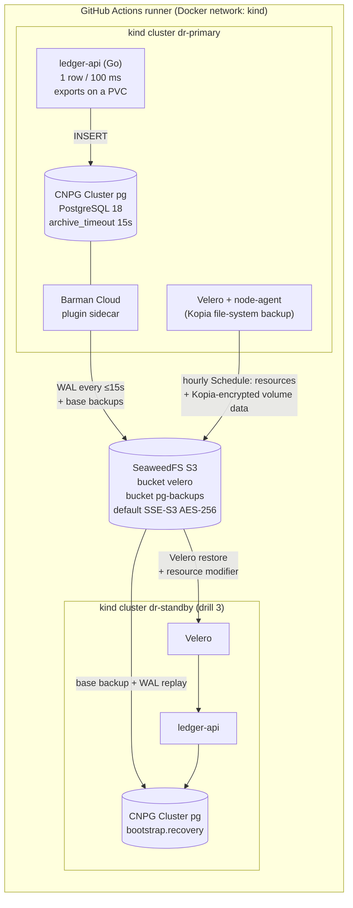

# k8s-disaster-recovery

[](https://github.com/ahmedelgmal310/k8s-disaster-recovery/actions/workflows/ci.yml)
[](https://github.com/ahmedelgmal310/k8s-disaster-recovery/actions/workflows/dr-drills.yml)
[](LICENSE)

Backup, restore and disaster recovery for a stateful service on Kubernetes, with
**measured RTO and RPO**. A Go API writes a steady stream of timestamped rows to
**PostgreSQL** run by **CloudNativePG**. **Velero** backs up the namespace and its
volume data, and CloudNativePG keeps **base backups plus continuous WAL archiving** for
point-in-time recovery. Everything lands **encrypted** in an S3-compatible object store
that lives outside the clusters.

The claim "we have backups" is only worth something if restores are tested. So every push
to `main`, and every Monday, CI breaks things on purpose and recovers them on
throwaway **kind** clusters:

1. The application namespace is deleted by accident.
2. Someone runs `DELETE FROM events` without a `WHERE` clause.
3. The whole Kubernetes cluster is lost.

Each drill measures how long the recovery took (RTO) and how much committed data was lost
(RPO). It checks every row and file it can, and **fails the job if a target is missed**.

## Contents

- [Results from CI](#results-from-ci)
- [Architecture](#architecture)
- [How it works](#how-it-works)
- [The drills](#the-drills)
- [Security of the backups](#security-of-the-backups)
- [Alerting](#alerting)
- [Limitations](#limitations)
- [DR runbook](#dr-runbook)
- [Repository layout](#repository-layout)
- [Running it yourself](#running-it-yourself)

## Results from CI

These numbers come from DR drills run
[#40610617405](https://github.com/ahmedelgmal310/k8s-disaster-recovery/actions/runs/40610617405)
on `main` (commit `02f4a00`), on a GitHub-hosted `ubuntu-latest` runner: kind v0.33.0,
Kubernetes v1.36.4, CloudNativePG 1.30.1, Barman Cloud plugin v0.15.1, PostgreSQL 18.6,
Velero 1.18.4, SeaweedFS 4.48. Every run uploads its own numbers as the `dr-results`
artifact (`results.json`, per-drill JSON, Velero backup and restore descriptions) and
posts them in the job summary.

| Drill | RTO (target) | RPO (target) | What was verified |
|---|---|---|---|
| **1. Namespace deleted** → one Velero restore, PostgreSQL from base backup + WAL | **40.9 s** (≤ 300 s) | **0.048 s** (≤ 60 s) | 423/423 archive-confirmed rows back, plus all 136 rows written after the last confirmed archive point; export file on the PVC restored with identical SHA-256 |
| **2. `DELETE FROM events` without `WHERE`** → point-in-time recovery | **50.8 s** (≤ 300 s) | **0.055 s** before the target time (≤ 1 s) | 837/837 deleted rows restored, 0 rows newer than the target replayed |
| **3. Whole cluster lost** → new cluster rebuilt from the object store | **185.7 s** (≤ 900 s) | **12.6 s** (≤ 60 s) | 1139/1139 archive-confirmed rows back; export file SHA-256 identical; RTO includes creating the cluster and installing the platform |

How to read them:

- **RTO** runs from the start of the recovery to the moment the API is ready *and* has
  committed a new row. Detection time is not included (see [Limitations](#limitations)).
- **RPO** is the gap between the incident (or the PITR target) and the newest row that came
  back, measured with the rows' own `clock_timestamp()`.
- **Drill 1 lost almost nothing** although the last 10 s of writes were not archived yet.
  Deleting the namespace shuts PostgreSQL down gracefully, and CloudNativePG archives the
  final WAL segment on shutdown.
- **Drill 3 lost 12.6 s.** `kind delete cluster` kills the node outright, so the open WAL
  segment is gone. The loss is bounded by `archive_timeout = 15s`. This is the realistic
  RPO for an abrupt loss with this configuration. Lower `archive_timeout` or add a
  synchronous standby in another failure domain to shrink it.
- **Drill 3 phases:** create kind cluster 30.2 s, install cert-manager + CNPG + plugin +
  Velero 75.6 s, Velero backup sync 31.5 s, Velero restore 9.3 s, PostgreSQL recovery
  37.0 s, API ready 2.1 s. The restore itself, from "backup visible" to "API writing", took
  **48.4 s**. The rest is building the cluster, which a pre-provisioned standby would skip.
- **Encryption check:** 60/60 objects in the Velero bucket and 46/46 in the PostgreSQL
  backup bucket report SSE-S3 `AES256`. The Kopia pack blobs contain no plaintext rows.
  The bucket holds 4 archive folders (`pg-g1` to `pg-g4`, one per recovery), each with a base
  backup.
- **Alert inputs:** all 8 metrics referenced by the alert rules were scraped from the
  live stack, and the last-backup timestamp was 14 s old.
- Each Velero restore reports 3 warnings, all of the form "CustomResourceDefinition ... already
  exists". Velero includes the CRDs of backed-up custom resources, and the operators
  installed them first. They are expected.

The CI workflow runs alongside the drills and gates the code: go vet, `go test -race` with
a coverage gate of 80% (integration tests against a real PostgreSQL), govulncheck,
golangci-lint, Trivy, Gitleaks, shellcheck, actionlint, hadolint, kubeconform and promtool
([run #40610617423](https://github.com/ahmedelgmal310/k8s-disaster-recovery/actions/runs/40610617423)).

## Architecture



The object store runs as a container on the runner's `kind` Docker network, **outside every
Kubernetes cluster**. Each cluster reaches it through a selector-less `Service`
(`s3.storage.svc`) with an `EndpointSlice` pointing at the container. When a cluster is
deleted, its backups survive, which is what makes drill 3 a real cluster-loss test.

## How it works

**Two backup layers, each doing what it is good at.**

| Layer | Tool | What it protects | Schedule and retention |
|---|---|---|---|
| Kubernetes objects and volumes | Velero 1.18, Kopia file-system backup | Every object labelled `app.kubernetes.io/part-of=ledger`: Deployment, Service, PVC and its data, Secrets, NetworkPolicies, and the CNPG `Cluster`, `ObjectStore` and `ScheduledBackup` definitions | `Schedule` `ledger-hourly`, TTL 7 days |
| Database | CloudNativePG 1.30 + Barman Cloud plugin 0.15 | Base backups and every WAL segment, gzip-compressed, SSE-S3 encrypted | `ScheduledBackup` daily at 02:00 UTC, WAL continuously (`archive_timeout` 15 s), retention policy `7d` recovery window |

Velero **does not** copy the PostgreSQL data directory. A file-level copy of a running
database is only crash-consistent. Instead, the operator's own objects (instance pods,
PGDATA PVCs, certificates) are left out of the Velero backup by the label selector. The
database always comes back from base backup + WAL, which is transaction-consistent and can
stop at any point in time.

**The glue is a Velero restore resource modifier**
([`deploy/platform/restore-modifiers.yaml`](deploy/platform/restore-modifiers.yaml)).
When Velero restores the `Cluster` object, a JSON merge patch replaces `bootstrap.initdb`
with `bootstrap.recovery` from the object store. So a single `velero restore create`
brings back the application *and* tells the operator to rebuild PostgreSQL from the WAL
archive.

**Each recovery archives to a new `serverName`** (`pg-g1` → `pg-g2` → ...). A recovered
cluster starts a new timeline. If it archived into the folder it was restored from, it
could overwrite the history that the next recovery needs. The new folder has no base backup
yet, so every drill takes one right after recovering. The `PostgresNoBaseBackup` alert
catches anyone who forgets that step.

**The service** ([`internal/`](internal), Go stdlib + pgx + Prometheus client):

| Endpoint | Purpose |
|---|---|
| `GET /healthz` | Liveness. It never touches the database, so a restore does not cause a restart loop |
| `GET /readyz` | Readiness: the database answers and the writer is committing rows |
| `GET /api/stats` | Row count, highest sequence number, newest `created_at`, last acknowledged write |
| `POST /api/exports`, `GET /api/exports` | Write a CSV of recent rows to the PVC, and list exports with a freshly computed SHA-256 |
| `GET /metrics` | `ledger_writes_total{result}`, `ledger_last_write_timestamp_seconds`, Go runtime |

The background writer inserts one row every 100 ms with `created_at = clock_timestamp()`.
That timestamp is the ruler for the RPO: lost data is the gap between the incident and
the newest row that came back.

## The drills

All three run in one job ([`.github/workflows/dr-drills.yml`](.github/workflows/dr-drills.yml))
on `push` to `main`, on pull requests, and on a weekly `schedule`. The scripts are in [`dr/`](dr).

**Drill 1: namespace deleted** ([`dr/drill-1-namespace.sh`](dr/drill-1-namespace.sh))

1. Write an export file to the PVC and record its SHA-256. Take a Velero backup from the
   hourly schedule's template.
2. Keep writing for 15 s, so some rows exist only in the WAL archive. Close a WAL segment
   and wait until it is archived. Every row before that point is *confirmed durable*.
3. Keep writing for 10 s more, so those rows exist only in an unarchived segment. Then run
   `kubectl delete namespace ledger`.
4. Start the clock. Run a Velero restore with the CNPG resource modifier. Wait until the
   cluster is `Ready` and the API has committed a new row.
5. **Pass if:** every confirmed row is back, the export file's SHA-256 matches, RTO ≤ 300 s
   and RPO ≤ 60 s.

**Drill 2: `DELETE` without `WHERE`** ([`dr/drill-2-pitr.sh`](dr/drill-2-pitr.sh))

1. In one `psql` session: count the rows, read `clock_timestamp()` as the recovery target,
   then `DELETE FROM events`. The writer keeps going. The archive must hold WAL past the
   target, or recovery cannot tell where to stop.
2. Start the clock. Scale the API to zero (stop writes), delete the damaged `Cluster`, and
   create it again with `bootstrap.recovery.recoveryTarget.targetTime`
   ([`deploy/ledger/cluster-pitr.yaml`](deploy/ledger/cluster-pitr.yaml)).
3. Before the writers come back, check that every pre-`DELETE` row is present and **no row
   newer than the target** was replayed. Then scale the API up.
4. **Pass if:** all rows are restored, zero rows are past the target, RPO ≤ 1 s before the
   target time, and RTO ≤ 300 s.

**Drill 3: cluster lost** ([`dr/drill-3-cluster.sh`](dr/drill-3-cluster.sh))

1. Take a fresh Velero backup, so it describes the cluster *after* drill 2 changed its spec.
   Confirm a WAL segment is archived and keep writing for 10 s.
2. `kind delete cluster`. The containers are force-removed, with no graceful shutdown.
3. Start the clock. Create a new kind cluster and install the platform from this repository
   ([`dr/platform.sh`](dr/platform.sh)). Give Velero the same S3 credentials and Kopia
   password from the break-glass store. Wait for Velero to sync the backup list from the
   bucket, then restore with the same resource modifier.
4. **Pass if:** every confirmed row is back, the export file's SHA-256 matches, RTO
   ≤ 900 s (including building the cluster) and RPO ≤ 60 s.

After the drills, [`dr/verify-encryption.sh`](dr/verify-encryption.sh) checks the bucket
contents, and [`dr/report.sh`](dr/report.sh) writes `results.json` and the job summary.
Both are uploaded as the `dr-results` artifact, together with the Velero backup and
restore descriptions.

## Security of the backups

| Control | How | Proven in CI by |
|---|---|---|
| Encryption at rest (server side) | Default SSE-S3 on both buckets; CNPG sends `encryption: AES256` for WAL and base backups, Velero sets `serverSideEncryption: AES256`; the key-encryption key is passed to the store at start-up, not stored with the data | `head-object` on every object reports `AES256` |
| Encryption at rest (client side) | Kopia encrypts all volume data with AES-256-GCM using the repository password before upload | Kopia pack blobs are downloaded and searched for the export CSV header: not found |
| Least privilege | Separate S3 identities: Velero can only use `velero`, CNPG can only use `pg-backups` | Each identity is denied a listing of the other bucket |
| No secrets in git | [`dr/secrets.sh`](dr/secrets.sh) creates random credentials, KEK, Kopia password and DB password per run, outside the workspace (mode 600), masked in logs | Gitleaks scans the full history on every push |
| Network | PostgreSQL accepts connections only from the API and the operator (`NetworkPolicy`); the API pod runs as non-root on distroless, read-only root FS, all capabilities dropped | Policies are applied and restored with the namespace |
| Supply chain | Actions pinned to commit SHAs, images to digests, release manifests to SHA-256 ([`docs/versions.md`](docs/versions.md)); govulncheck, Trivy, golangci-lint (gosec), shellcheck, actionlint, hadolint | [`ci.yml`](.github/workflows/ci.yml) |

## Alerting

[`monitoring/rules/backup-alerts.yml`](monitoring/rules/backup-alerts.yml) has seven alerts,
and [`monitoring/tests/backup-alerts.test.yml`](monitoring/tests/backup-alerts.test.yml)
unit-tests every one of them with `promtool test rules`. The tests cover both the firing
case and a quiet case (for example, healthy daily backups, a transient archiving failure that
recovers, a replica whose archive counter grows, and failures of manual backups that
are not part of the schedule).

| Alert | Fires when | Severity |
|---|---|---|
| `PostgresBaseBackupTooOld` | newest base backup > 26 h old (daily schedule + margin) | warning |
| `PostgresBaseBackupFailed` | last failed backup is newer than the last successful one | warning |
| `PostgresNoBaseBackup` | a cluster has no base backup for 1 h, so WAL alone cannot be recovered | critical |
| `PostgresWALArchivingFailing` | `archive_command` failures in the last 5 m, sustained 2 m | critical |
| `PostgresWALArchiveStale` | primary has not archived for > 5 m although `archive_timeout` is 15 s | critical |
| `VeleroBackupTooOld` | no successful scheduled Velero backup for > 3 h (hourly schedule) | warning |
| `VeleroBackupFailed` | a scheduled backup failed or partially failed in the last 2 h | warning |

Unit tests only prove the logic. CI also proves the inputs are real:
[`dr/verify-metrics.sh`](dr/verify-metrics.sh) extracts every `cnpg_`, `barman_` and
`velero_` metric name from the rules and scrapes the live CNPG instance and Velero server.
It fails if any metric is missing, or if the last-backup timestamp is not fresh. A metric
renamed in an upgrade therefore breaks the build instead of silently disabling an alert.
[`monitoring/podmonitor.yaml`](monitoring/podmonitor.yaml) shows the scrape config for the
Prometheus Operator, including the `cluster` label the rules aggregate by.

## Limitations

These numbers come from a deliberately small, single-node setup. Before you rely on them,
know what they do **not** show:

- **Tiny dataset.** A few thousand rows and a few MB of WAL. Real restore time grows with
  base backup size and the amount of WAL to replay. Treat these RTOs as a lower bound for
  this architecture, not a promise for a 500 GB database. Take base backups more often if
  WAL replay dominates.
- **One PostgreSQL instance, one node.** There are no replicas, so the drills measure
  restore from backup, not failover. With `instances: 3`, losing a node is a failover in
  seconds, and new replicas also have to clone before full redundancy returns.
- **The object store is a single container on the same runner.** It survives cluster loss,
  not site loss. In production it must be off-site (another region or account), replicated,
  and preferably immutable (versioning + object lock) so ransomware or a compromised
  credential cannot delete the backups. None of that is implemented here.
- **Key management is minimal.** SSE-S3 uses a key-encryption key passed as an environment
  variable, and S3 traffic is plain HTTP on the Docker bridge. Production should use SSE-KMS
  with an external KMS and TLS (`endpointCA` in the `ObjectStore`, `caCert` in the BSL).
  Velero's resource tarballs, which include Secrets, are protected only by SSE, not
  client-side encryption.
- **RTO excludes detection.** CI knows when it broke something. In a real incident, add the
  alert delay and the time for a human to decide. The `for:` durations alone add 2 to 15
  minutes.
- **Drill 3 RTO includes building the cluster and pulling images** on a GitHub-hosted
  runner. A pre-built standby cluster, or images in a local registry, would remove most of
  that. The job summary shows the phases separately.
- **Retention is configured, not exercised.** The 7-day Velero TTL and CNPG recovery window
  are set, but CI runs for minutes, so it never sees a backup expire.
- **Schedules are defined, but drills do not wait for them.** Drills create backups from
  the schedule's template (`velero backup create --from-schedule`) and on-demand CNPG
  `Backup` objects. The cron schedules themselves only run in a long-lived cluster.
- **PITR discards writes after the target.** Drill 2 stops the writers and rewinds the whole
  database. Rows written after the bad `DELETE` are lost by design. A real incident might
  instead restore to a side cluster and copy back only the deleted rows.
- **Why not MinIO:** its community container images are no longer published and the
  repository is archived, so SeaweedFS (Apache-2.0, actively maintained, SSE-S3 support)
  is the S3 store here. Velero and Barman only need standard S3 APIs, so any compatible
  store works.
- The API connects to PostgreSQL with `sslmode=require` (encrypted, but the server
  certificate is not verified), because the cluster CA is recreated on every recovery.

## DR runbook

Assumes `kubectl` and the `velero` CLI point at the affected cluster, and `NS=ledger`.

### Before you need it

- **Break-glass secrets** live outside the cluster: S3 credentials for Velero and CNPG,
  the **Kopia repository password** (without it, the volume backups cannot be read), and
  the object store's encryption key. Drill 3 rebuilds a cluster using only these and this
  repository.
- Know the current archive folder: `kubectl -n $NS get cluster pg -o jsonpath='{.spec.plugins[0].parameters.serverName}'`.
  If the cluster is gone, list the bucket: `aws s3 ls s3://pg-backups/` (the highest `pg-gN`
  is the newest).
- Health at a glance:

  ```sh
  velero backup get                                   # newest Completed backup per schedule
  kubectl -n $NS get backups.postgresql.cnpg.io       # base backups and their phase
  kubectl -n $NS get objectstore backup-store -o jsonpath='{.status.serverRecoveryWindow}'
  ```

### Namespace deleted (or a workload's objects destroyed)

1. Make sure the namespace is fully gone: `kubectl get ns $NS` returns NotFound.
2. Pick the newest good backup: `velero backup get`.
3. Render the modifier with the archive folder to restore from (`SOURCE_SERVER`) and a
   **new** one to archive to (`SERVER_NAME`):

   ```sh
   SOURCE_SERVER=pg-g1 SERVER_NAME=pg-g2 envsubst '${SOURCE_SERVER} ${SERVER_NAME}' \
     < deploy/platform/restore-modifiers.yaml | kubectl apply -f -
   velero restore create --from-backup <backup> --resource-modifier-configmap ledger-restore-modifiers --wait
   velero restore describe <restore> --details        # Completed, kopia restore of "data"
   ```

4. Wait for `kubectl -n $NS wait --for=condition=Ready cluster/pg --timeout=15m`, then
   check `/readyz`.
5. **Take a base backup now.** The new folder has none:
   `kubectl cnpg backup pg -n $NS --method=plugin --plugin-name=barman-cloud.cloudnative-pg.io`.

### Bad data (`DELETE`/`UPDATE` without `WHERE`, bad migration)

1. Find the target time, which is the last good moment. Use the application log, the audit
   log, or `pg_stat_statements`. Record it in UTC with microseconds.
2. **Stop the writers:** `kubectl -n $NS scale deploy/ledger-api --replicas=0`.
3. Optional and safer: restore to a side cluster first (a different `metadata.name`) and
   compare the data before you touch production.
4. Replace the cluster with a point-in-time recovery:

   ```sh
   kubectl -n $NS delete cluster pg
   PG_IMAGE=<image> SOURCE_SERVER=pg-g2 SERVER_NAME=pg-g3 TARGET_TIME="2026-10-28 00:32:30.014004+00" \
     envsubst < deploy/ledger/cluster-pitr.yaml | kubectl apply -f -
   ```

5. Verify the data while writers are still stopped, then scale the API back up and
   **take a base backup**.

### Cluster lost

1. Create a cluster and point it at the object store (in CI, [`dr/cluster-up.sh`](dr/cluster-up.sh)).
2. Install the platform with the break-glass secrets: [`dr/platform.sh`](dr/platform.sh).
   It needs the **same Kopia repository password** as the lost cluster.
3. Wait until `velero backup get` lists the lost cluster's backups (sync period 10 s here).
4. Restore exactly as in [Namespace deleted](#namespace-deleted-or-a-workloads-objects-destroyed),
   step 3 onward.
5. Repoint DNS or ingress to the new cluster, then take a base backup.

### Base backup too old or failed

`PostgresBaseBackupTooOld`, `PostgresBaseBackupFailed`, `PostgresNoBaseBackup`

1. `kubectl -n $NS get backups.postgresql.cnpg.io --sort-by=.metadata.creationTimestamp` and
   `kubectl -n $NS describe backup <newest>` show the phase and error.
2. Read the plugin sidecar: `kubectl -n $NS logs pg-1 -c plugin-barman-cloud --tail=100`.
   Common causes: expired or rotated S3 credentials (`pg-backup-s3`), a full bucket or
   quota, or a deleted `ObjectStore`.
3. After a recovery (new `serverName`) with no backup yet, run an on-demand backup (see
   above). Recovery from this folder is impossible until one exists.
4. Fix the cause, run an on-demand backup, and confirm the alert clears.

### WAL archiving failing

`PostgresWALArchivingFailing`, `PostgresWALArchiveStale`. This is the most urgent backup
alert. Until it is fixed, the RPO after a loss grows by the minute, and `pg_wal` fills
the volume.

1. `kubectl -n $NS exec pg-1 -c postgres -- psql -c 'select * from pg_stat_archiver'`
   shows `last_failed_wal` and `last_failed_time`.
2. `kubectl -n $NS logs pg-1 -c plugin-barman-cloud --tail=100` shows the S3 error
   (credentials, DNS, TLS, permissions, "WAL archive not empty" after a restore that reused
   a `serverName`).
3. Watch `pg_wal` usage: `kubectl -n $NS exec pg-1 -c postgres -- du -sh /var/lib/postgresql/data/pgdata/pg_wal`.
   If it gets close to full, expand the PVC before PostgreSQL stops accepting writes.
4. Once fixed, archiving catches up on its own. Confirm that `last_archived_time` moves.

### Velero backup too old or failed

`VeleroBackupTooOld`, `VeleroBackupFailed`

1. `velero schedule get` (is it `Enabled`, when was the last backup?) and `velero backup get`.
2. `velero backup describe <name> --details` and `velero backup logs <name>`. A
   `PartiallyFailed` backup often means a volume was skipped. Check the "Pod Volume
   Backups" section for `data`.
3. `kubectl -n velero get backupstoragelocation` must be `Available`. If not, check
   credentials and the bucket.
4. Fix it, then run `velero backup create --from-schedule ledger-hourly --wait`.

## Repository layout

```
cmd/ledger-api/             entrypoint
internal/                   store (pgx), writer, exports (PVC files + SHA-256), HTTP server, app wiring
deploy/ledger/              namespace, CNPG Cluster (initdb / PITR), ObjectStore, ScheduledBackup, API, NetworkPolicies
deploy/platform/            Velero values, hourly Schedule, restore resource modifier, S3 endpoint
deploy/kind/                kind cluster config
monitoring/                 alert rules, promtool unit tests, PodMonitor
dr/                         drill scripts: secrets, object store, cluster, platform, deploy, drills, verification, report
docs/versions.md            every pinned version, digest and checksum
.github/workflows/          ci.yml (lint, tests, scans), dr-drills.yml (drills on push + weekly)
```

## Running it yourself

```sh
go test -race ./...                                          # unit tests
DATABASE_URL=postgres://user@localhost/db go test ./...       # plus PostgreSQL integration tests
promtool test rules monitoring/tests/backup-alerts.test.yml  # alert unit tests
```

The full drills need Docker, kind, kubectl, helm, the velero CLI, jq and the AWS CLI:

```sh
docker build -t ledger-api:ci .
./dr/secrets.sh && ./dr/cluster-up.sh dr-primary && ./dr/platform.sh && ./dr/deploy-app.sh
./dr/verify-metrics.sh
./dr/drill-1-namespace.sh && ./dr/drill-2-pitr.sh && ./dr/drill-3-cluster.sh dr-primary dr-standby
./dr/verify-encryption.sh && ./dr/report.sh                  # results in dr-results/
```

## License

[MIT](LICENSE) © 2026 Ahmed Elgamal
